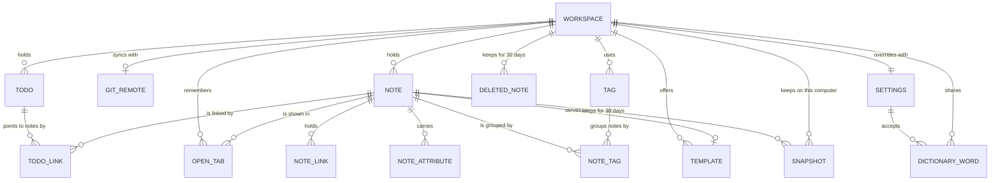

# Entity Model

The business objects of Underline as the user sees them. Where they are kept (files in the workspace, the settings
files) is a technical decision and not part of this model.

## Entity Relationship Diagram

### WORKSPACE

A local directory whose Markdown and AsciiDoc files Underline shows as notes.

| Attribute         | Description                                                    | Data Type | Length/Precision | Validation Rules             |
|-------------------|----------------------------------------------------------------|-----------|------------------|------------------------------|
| directory         | Location of the workspace directory on the local disk          | String    | 500              | Primary Key                  |
| name              | Name shown to the user, the directory name unless changed      | String    | 100              | Not Null                     |
| is_git_repository | Whether the workspace is a git repository                      | Boolean   | 1                | Not Null                     |
| current_branch    | The git branch the workspace is on                             | String    | 250              | Optional                     |
| last_opened       | When the user last opened the workspace                        | DateTime  | -                | Optional                     |

#### Constraints

- A workspace has a current branch exactly when it is a git repository.

### NOTE

One Markdown or AsciiDoc file in a workspace.

| Attribute    | Description                                                       | Data Type | Length/Precision | Validation Rules                            |
|--------------|-------------------------------------------------------------------|-----------|------------------|---------------------------------------------|
| workspace    | The workspace the note belongs to                                 | String    | 500              | Primary Key, Foreign Key (WORKSPACE.directory) |
| path         | Location of the note inside the workspace, with its file name    | String    | 500              | Primary Key                                 |
| title        | Title shown to the user, taken from the file name                 | String    | 250              | Not Null                                    |
| note_format  | Note format, given by the file extension                         | String    | 20               | Not Null, Values: Markdown, AsciiDoc        |
| content      | The text of the note in its note format                           | String    | -                | Not Null                                    |
| last_changed | When the note was last saved                                      | DateTime  | -                | Not Null                                    |
| last_opened  | When the user last opened the note, for the note overview        | DateTime  | -                | Optional                                    |

#### Constraints

- Two notes in the same folder of a workspace never have the same title, ignoring upper and lower case and the note
  format; notes in different folders may.
- A note belongs to exactly one workspace: a folder that is a workspace of its own is not part of the workspace
  around it.
- The note format matches the extension of the path: `.md` for Markdown, `.adoc` for AsciiDoc.

### GIT_REMOTE

The git repository elsewhere that a workspace pulls from and pushes to.

| Attribute        | Description                                          | Data Type | Length/Precision | Validation Rules                            |
|------------------|------------------------------------------------------|-----------|------------------|---------------------------------------------|
| workspace        | The workspace that syncs with this remote            | String    | 500              | Primary Key, Foreign Key (WORKSPACE.directory) |
| name             | Name of the remote in the repository, origin by default | String | 100              | Not Null                                    |
| address          | Address of the remote repository                     | String    | 500              | Not Null                                    |
| last_sync        | When the last git sync ran                           | DateTime  | -                | Optional                                    |
| last_sync_result | Outcome of the last git sync                         | String    | 20               | Optional, Values: Success, Conflict, Failed |

#### Constraints

- A workspace has a git remote only when it is a git repository.
- The last sync result is given exactly when the last sync is.

### TODO

A piece of work the user is heading towards, kept in a workspace.

| Attribute      | Description                                          | Data Type | Length/Precision | Validation Rules                                |
|----------------|------------------------------------------------------|-----------|------------------|-------------------------------------------------|
| number         | Number of the todo within its workspace              | Long      | 19               | Primary Key, Sequence                           |
| workspace      | The workspace the todo belongs to                    | String    | 500              | Not Null, Foreign Key (WORKSPACE.directory)     |
| title          | What has to be done                                  | String    | 200              | Not Null                                        |
| due_date       | Date by which the todo has to be done                | Date      | -                | Optional                                        |
| urgency        | How pressing the todo is                             | String    | 20               | Not Null, Values: Low, Normal, High, Critical   |
| scheduled_date | Day the user plans to work on the todo               | Date      | -                | Optional                                        |
| status         | Whether the todo is still to do                      | String    | 20               | Not Null, Values: Open, Done                    |
| created_at     | When the todo was created                            | DateTime  | -                | Not Null                                        |
| done_at        | When the todo was marked as done                     | DateTime  | -                | Optional                                        |

#### Constraints

- A todo has a done date exactly when its status is Done.
- A new todo is Open with the urgency Normal unless the user chooses another.

### TODO_LINK

A link from a todo to one note it is about; a todo has none, one, or several.

| Attribute | Description                       | Data Type | Length/Precision | Validation Rules                        |
|-----------|-----------------------------------|-----------|------------------|-----------------------------------------|
| todo      | The todo that points to the note  | Long      | 19               | Primary Key, Foreign Key (TODO.number)  |
| note      | The note the todo points to       | String    | 500              | Primary Key, Foreign Key (NOTE.path)    |

#### Constraints

- The note and the todo belong to the same workspace.
- A note that a todo link points to cannot be deleted; the link has to be removed first.
- When a note is renamed, its todo links follow it.

### SETTINGS

The settings of the user settings file or of one workspace settings file.

| Attribute          | Description                                                        | Data Type | Length/Precision | Validation Rules |
|--------------------|--------------------------------------------------------------------|-----------|------------------|------------------|
| id                 | Identifier of the set of settings                                  | Long      | 19               | Primary Key, Sequence |
| scope              | Whether these are the user settings or the settings of a workspace | String    | 20               | Not Null, Values: User, Workspace |
| workspace          | The workspace these settings belong to                             | String    | 500              | Optional, Unique, Foreign Key (WORKSPACE.directory) |
| default_format     | Note format given to new notes of the workspace                    | String    | 20               | Optional, Values: Markdown, AsciiDoc |
| theme              | Theme of the interface                                             | String    | 30               | Optional, Values: Light, Dark, GitHub Light, GitHub Dark, Solarized Light, Solarized Dark, Night Owl, Ubuntu, Nord, Dracula, Gruvbox |
| input_mode         | Input mode of the editor                                           | String    | 20               | Optional, Values: Normal, Vim, Nano |
| show_line_numbers  | Whether line numbers are shown                                     | Boolean   | 1                | Optional |
| line_number_side   | Side of the editor the line numbers are shown on                   | String    | 10               | Optional, Values: Left, Right |
| copy_on_select     | Whether a selection is copied to the clipboard at once             | Boolean   | 1                | Optional |
| show_minimap       | Whether the minimap is shown beside the editor                     | Boolean   | 1                | Optional |
| git_sync_interval  | Minutes between two git syncs                                      | Integer   | 10               | Optional, Min: 1, Max: 60 |
| agent_access       | What the MCP server lets an agent do with the notes                | String    | 14               | Optional, Values: Off, Read only, Read and write |
| overview_width     | Width of the note overview, in pixels                              | Integer   | 10               | Optional, Min: 100, Max: 1000 |
| tool_panel_width   | Width of the tool panel, in pixels                                 | Integer   | 10               | Optional, Min: 100, Max: 1000 |
| editor_zoom        | Size of the text of the notes, in percent of its normal size       | Integer   | 10               | Optional, Min: 50, Max: 300 |
| soft_wrap          | Whether lines longer than the editor is wide are wrapped           | Boolean   | 1                | Optional |
| focus_mode         | Whether the focus mode is on                                       | Boolean   | 1                | Optional |
| close_pairs        | Whether brackets, quotes, and inline markup are closed while typing | Boolean  | 1                | Optional |
| spell_check_language | Language of the spell check, or Off                              | String    | 30               | Optional, Values: Off, English (US), English (UK), German (Germany), German (Switzerland), French, Italian, Spanish |
| template_folder    | Folder of the workspace that holds its templates                   | String    | 500              | Optional |
| daily_note_folder  | Folder of the workspace that holds its daily notes                 | String    | 500              | Optional |
| daily_note_template | Template a new daily note starts from                             | String    | 500              | Optional |

#### Constraints

- There is exactly one set of settings with the scope User, and it has no workspace.
- A set of settings with the scope Workspace has a workspace, and every workspace has exactly one such set.
- The default format is never given in the user settings. A workspace created in Underline has it in its settings,
  chosen when it was created; a workspace whose settings do not give it uses the note format most of its notes have,
  Markdown on a tie or without notes.
- In the user settings every setting has a value; the built-in default fills any value the user never set (theme
  Light, input mode Normal, line numbers shown on the left, minimap shown, copy on select on, git sync every 5
  minutes, agent access off, note overview 200 and tool panel 240 pixels wide, editor zoom 100 percent, soft wrap on,
  focus mode off, close pairs on, and the spell check in the language of the system when it is one of the offered
  languages, otherwise off).
- The template folder, the daily note folder, and the daily note template are never given in the user settings. A
  workspace whose settings do not give them uses the folder `templates`, the folder `daily`, and the template titled
  Daily in its template folder when there is one, otherwise none.
- Editor zoom changes in steps of 10 percent.
- In workspace settings an empty value means that the user setting applies.
- Workspace settings can lower agent access (to read only or off) but never raise it; only the user settings can raise it.
- A setting the user changes in the interface is stored in the workspace settings when they already give it a value,
  otherwise in the user settings.

### OPEN_TAB

A note the user has open in a tab, remembered so the tabs come back after a restart.

| Attribute    | Description                                       | Data Type | Length/Precision | Validation Rules                               |
|--------------|---------------------------------------------------|-----------|------------------|------------------------------------------------|
| workspace    | The workspace the tab belongs to                  | String    | 500              | Primary Key, Foreign Key (WORKSPACE.directory) |
| pane         | The pane of the split view the tab is in, Left or Right; Left without the split view | String | 10 | Primary Key                          |
| note         | The note shown in the tab                         | String    | 500              | Primary Key, Foreign Key (NOTE.path)           |
| position     | Place of the tab from the left of its pane, starting at 1 | Integer | 10           | Not Null, Min: 1, Max: 100                     |
| editing_view | Editing view the tab shows the note in            | String    | 20               | Not Null, Values: Source, Facade               |
| is_active    | Whether this is the tab its pane shows            | Boolean   | 1                | Not Null                                       |

#### Constraints

- A note is open in at most one tab of each pane (workspace, pane, and note are unique together), so it can be open
  in both panes at once, for example in the source view on one side and in the facade on the other.
- The pane is Left or Right; a workspace has tabs in the right pane only while the split view is shown.
- No two tabs of the same pane have the same position.
- At most one tab of a pane is active, and exactly one while the pane has any tab.
- A workspace has at most 100 open tabs, both panes together.

### DELETED_NOTE

A note the user deleted (UC-007), kept with its content so it can be restored; kept on this computer only.

| Attribute  | Description                                             | Data Type | Length/Precision | Validation Rules         |
|------------|---------------------------------------------------------|-----------|------------------|--------------------------|
| path       | The place the note had in the workspace                 | String    | 500              | Primary Key (with deleted_at) |
| content    | The content of the note when it was deleted             | Text      | -                | Not Null                 |
| deleted_at | When the note was deleted                               | DateTime  | -                | Primary Key (with path)  |

#### Constraints

- A deleted note is removed for good 30 days after it was deleted, or earlier when the user empties the deleted notes.
- A deleted note is not listed in the note overview, not searched, and not read by agents.
- The same place may have been deleted several times; each is kept on its own.

### NOTE_LINK

A link that a note holds, to another note, to a file, or to a web address; the outgoing links of the note, and the
backlinks of the note it leads to. A picture the note shows and a file it includes are links too (OQ-244).

| Attribute | Description                                                              | Data Type | Length/Precision | Validation Rules                         |
|-----------|--------------------------------------------------------------------------|-----------|------------------|------------------------------------------|
| note      | The note that holds the link                                             | String    | 500              | Primary Key, Foreign Key (NOTE.path)     |
| line      | Line of the note that holds the link, counted from 1                    | Integer   | 10               | Primary Key                              |
| column    | Place of the link in its line, in characters counted from 1             | Integer   | 10               | Primary Key                              |
| kind      | What the link leads to                                                  | String    | 20               | Not Null, Values: Note, File, Web address |
| form      | How the note names what it leads to                                     | String    | 20               | Not Null, Values: Link, Picture, Include  |
| target    | Place of the note or file in the workspace, or the web address           | String    | 2000             | Not Null                                 |
| heading   | The heading of the linked note the link names                            | String    | 250              | Optional                                 |
| text      | The text of the link as the note shows it                                | String    | 500              | Optional                                 |
| is_broken | Whether the note, file, or heading the link leads to is missing          | Boolean   | 1                | Not Null                                 |

#### Constraints

- Note links are read from the content of the note; they change only when the note changes, and they are never
  written on their own.
- A link of the kind Web address is never broken; whether the address can be reached is not checked.
- A link of the kind Note leads to a note of the same workspace; it is a backlink of that note unless it is held by
  that note itself.
- A link of the form Include is held only by an AsciiDoc note.
- An unlinked mention (UC-004 BR-021) is no note link: it is the title of a note standing as plain text in another
  note, found from the content of that note as the links are, and it becomes a note link only when the user links it
  (UC-004 A22).

### NOTE_ATTRIBUTE

A named value kept at the head of a note: a field of the front matter of a Markdown note, or a document attribute of
an AsciiDoc note.

| Attribute | Description                                                         | Data Type | Length/Precision | Validation Rules                                   |
|-----------|---------------------------------------------------------------------|-----------|------------------|----------------------------------------------------|
| note      | The note that carries the attribute                                 | String    | 500              | Primary Key, Foreign Key (NOTE.path)               |
| name      | Name of the attribute                                               | String    | 100              | Primary Key                                        |
| kind      | What the value holds                                                | String    | 20               | Not Null, Values: Text, List, Number, Date, Yes or no, Nested |
| value     | The value as the note holds it; a list as its items, one per entry  | String    | 2000             | Optional                                           |
| position  | Place of the attribute at the head of the note, counted from 1      | Integer   | 10               | Not Null, Min: 1, Max: 1000                        |

#### Constraints

- No two attributes of a note have the same name.
- An AsciiDoc note holds only attributes of the kinds Text and List; a list is written with its items separated by
  commas.
- An attribute of the kind Nested, such as a field with fields of its own, is shown but changed only in the source
  view.
- The attribute named `tags` holds tags of the note (NOTE_TAG).

### TAG

A word that groups notes across folders of a workspace.

| Attribute | Description                                                           | Data Type | Length/Precision | Validation Rules                               |
|-----------|-----------------------------------------------------------------------|-----------|------------------|------------------------------------------------|
| workspace | The workspace whose notes carry the tag                               | String    | 500              | Primary Key, Foreign Key (WORKSPACE.directory) |
| name      | The tag without its `#`, as most notes write it                        | String    | 100              | Primary Key                                    |

#### Constraints

- Two tags that differ only in upper and lower case are the same tag.
- A tag exists while at least one note of the workspace carries it.
- A tag holds letters, digits, `_`, `-`, and `/`, and at least one character that is not a digit; a `/` makes a tag
  a part of the tag before it (`project/alpha` belongs to `project`).

### NOTE_TAG

That a note carries a tag, in its text, in its note attribute `tags`, or in both.

| Attribute | Description                                   | Data Type | Length/Precision | Validation Rules                       |
|-----------|-----------------------------------------------|-----------|------------------|----------------------------------------|
| note      | The note that carries the tag                 | String    | 500              | Primary Key, Foreign Key (NOTE.path)   |
| tag       | The tag the note carries                      | String    | 100              | Primary Key, Foreign Key (TAG.name)    |
| origin    | Where the note carries it                     | String    | 20               | Not Null, Values: Text, Attribute, Both |

#### Constraints

- The note and the tag belong to the same workspace.
- An AsciiDoc note carries tags only in its note attribute `tags`.

### TEMPLATE

A note in the template folder of a workspace that a new note can start from.

| Attribute | Description                         | Data Type | Length/Precision | Validation Rules                               |
|-----------|-------------------------------------|-----------|------------------|------------------------------------------------|
| workspace | The workspace that offers it        | String    | 500              | Primary Key, Foreign Key (WORKSPACE.directory) |
| note      | The note that serves as the template | String   | 500              | Primary Key, Foreign Key (NOTE.path)           |

#### Constraints

- A note is a template exactly when it lies in the template folder of its workspace (SETTINGS.template_folder) or in
  a folder below it.
- A new note made from a template gets the note format of the template.

### SNAPSHOT

An earlier version of a note, kept on this computer only so the user can compare and restore it.

| Attribute | Description                                         | Data Type | Length/Precision | Validation Rules                                   |
|-----------|-----------------------------------------------------|-----------|------------------|----------------------------------------------------|
| workspace | The workspace of the note                           | String    | 500              | Primary Key, Foreign Key (WORKSPACE.directory)     |
| note      | The note the snapshot belongs to                    | String    | 500              | Primary Key, Foreign Key (NOTE.path)               |
| taken_at  | When the snapshot was taken                         | DateTime  | -                | Primary Key                                        |
| content   | The content the note had at that moment             | String    | -                | Not Null                                           |
| cause     | Why the snapshot was taken                          | String    | 30               | Not Null, Values: Editing, Outside change, Agent change, Replace in workspace, Git, Restore |

#### Constraints

- A snapshot is removed 30 days after it was taken.
- Two snapshots of the same note one after the other never hold the same content.
- The snapshots of a renamed or moved note follow it; those of a deleted note are kept with the deleted note
  (DELETED_NOTE) and come back when it is restored.
- Snapshots are not listed in the note overview, not searched, not read by agents, and not seen by git.

### DICTIONARY_WORD

A word the user has added to the spell check, to the user dictionary or to the workspace dictionary, so that it is
never marked.

| Attribute | Description                                            | Data Type | Length/Precision | Validation Rules                      |
|-----------|--------------------------------------------------------|-----------|------------------|---------------------------------------|
| word      | The word as the user added it                          | String    | 100              | Primary Key                           |
| settings  | The user settings the word belongs to                  | Long      | 19               | Optional, Foreign Key (SETTINGS.id)   |
| workspace | The workspace whose dictionary holds the word          | String    | 500              | Optional, Foreign Key (WORKSPACE.directory) |
| added_at  | When the word was added                                | DateTime  | -                | Not Null                              |

#### Constraints

- A word belongs either to the set of settings with the scope User (the user dictionary) or to a workspace (the
  workspace dictionary, OQ-208).
- Words of the user dictionary count in every workspace and every language.
- Words of the workspace dictionary count in every language, in that workspace only; the workspace dictionary is kept
  in the workspace and shared with it, as its notes are.
- A word holds no spaces.
