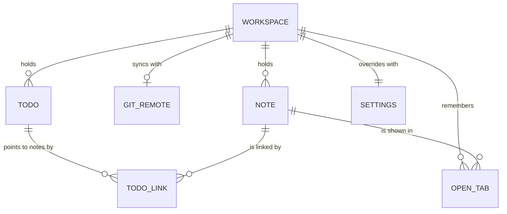

# Entity Model

The business objects of Underline as the user sees them. Where they are kept (files in the workspace, the settings
files) is a technical decision and not part of this model.

## Entity Relationship Diagram

### WORKSPACE

A local directory whose Markdown and AsciiDoc files Underline shows as notes.

| Attribute         | Description                                                    | Data Type | Length/Precision | Validation Rules             |
|-------------------|----------------------------------------------------------------|-----------|------------------|------------------------------|
| directory         | Location of the workspace directory on the local disk          | String    | 500              | Primary Key                  |
| name              | Name shown to the user, the directory name unless changed      | String    | 100              | Not Null                     |
| is_git_repository | Whether the workspace is a git repository                      | Boolean   | 1                | Not Null                     |
| current_branch    | The git branch the workspace is on                             | String    | 250              | Optional                     |
| last_opened       | When the user last opened the workspace                        | DateTime  | -                | Optional                     |

#### Constraints

- A workspace has a current branch exactly when it is a git repository.

### NOTE

One Markdown or AsciiDoc file in a workspace.

| Attribute    | Description                                                       | Data Type | Length/Precision | Validation Rules                            |
|--------------|-------------------------------------------------------------------|-----------|------------------|---------------------------------------------|
| workspace    | The workspace the note belongs to                                 | String    | 500              | Primary Key, Foreign Key (WORKSPACE.directory) |
| path         | Location of the note inside the workspace, with its file name    | String    | 500              | Primary Key                                 |
| title        | Title shown to the user, taken from the file name                 | String    | 250              | Not Null                                    |
| note_format  | Note format, given by the file extension                         | String    | 20               | Not Null, Values: Markdown, AsciiDoc        |
| content      | The text of the note in its note format                           | String    | -                | Not Null                                    |
| last_changed | When the note was last saved                                      | DateTime  | -                | Not Null                                    |
| last_opened  | When the user last opened the note, for the note overview        | DateTime  | -                | Optional                                    |

#### Constraints

- Two notes in the same folder of a workspace never have the same title; notes in different folders may.
- The note format matches the extension of the path: `.md` for Markdown, `.adoc` for AsciiDoc.

### GIT_REMOTE

The git repository elsewhere that a workspace pulls from and pushes to.

| Attribute        | Description                                          | Data Type | Length/Precision | Validation Rules                            |
|------------------|------------------------------------------------------|-----------|------------------|---------------------------------------------|
| workspace        | The workspace that syncs with this remote            | String    | 500              | Primary Key, Foreign Key (WORKSPACE.directory) |
| name             | Name of the remote in the repository, origin by default | String | 100              | Not Null                                    |
| address          | Address of the remote repository                     | String    | 500              | Not Null                                    |
| last_sync        | When the last git sync ran                           | DateTime  | -                | Optional                                    |
| last_sync_result | Outcome of the last git sync                         | String    | 20               | Optional, Values: Success, Conflict, Failed |

#### Constraints

- A workspace has a git remote only when it is a git repository.
- The last sync result is given exactly when the last sync is.

### TODO

A piece of work the user is heading towards, kept in a workspace.

| Attribute      | Description                                          | Data Type | Length/Precision | Validation Rules                                |
|----------------|------------------------------------------------------|-----------|------------------|-------------------------------------------------|
| number         | Number of the todo within its workspace              | Long      | 19               | Primary Key, Sequence                           |
| workspace      | The workspace the todo belongs to                    | String    | 500              | Not Null, Foreign Key (WORKSPACE.directory)     |
| title          | What has to be done                                  | String    | 200              | Not Null                                        |
| due_date       | Date by which the todo has to be done                | Date      | -                | Optional                                        |
| urgency        | How pressing the todo is                             | String    | 20               | Not Null, Values: Low, Normal, High, Critical   |
| scheduled_date | Day the user plans to work on the todo               | Date      | -                | Optional                                        |
| status         | Whether the todo is still to do                      | String    | 20               | Not Null, Values: Open, Done                    |
| created_at     | When the todo was created                            | DateTime  | -                | Not Null                                        |
| done_at        | When the todo was marked as done                     | DateTime  | -                | Optional                                        |

#### Constraints

- A todo has a done date exactly when its status is Done.
- A new todo is Open with the urgency Normal unless the user chooses another.

### TODO_LINK

A link from a todo to one note it is about; a todo has none, one, or several.

| Attribute | Description                       | Data Type | Length/Precision | Validation Rules                        |
|-----------|-----------------------------------|-----------|------------------|-----------------------------------------|
| todo      | The todo that points to the note  | Long      | 19               | Primary Key, Foreign Key (TODO.number)  |
| note      | The note the todo points to       | String    | 500              | Primary Key, Foreign Key (NOTE.path)    |

#### Constraints

- The note and the todo belong to the same workspace.
- A note that a todo link points to cannot be deleted; the link has to be removed first.
- When a note is renamed, its todo links follow it.

### SETTINGS

The settings of the user settings file or of one workspace settings file.

| Attribute          | Description                                                        | Data Type | Length/Precision | Validation Rules |
|--------------------|--------------------------------------------------------------------|-----------|------------------|------------------|
| id                 | Identifier of the set of settings                                  | Long      | 19               | Primary Key, Sequence |
| scope              | Whether these are the user settings or the settings of a workspace | String    | 20               | Not Null, Values: User, Workspace |
| workspace          | The workspace these settings belong to                             | String    | 500              | Optional, Unique, Foreign Key (WORKSPACE.directory) |
| default_format     | Note format given to new notes of the workspace                    | String    | 20               | Optional, Values: Markdown, AsciiDoc |
| theme              | Theme of the interface                                             | String    | 30               | Optional, Values: Light, Dark, GitHub Light, GitHub Dark, Solarized Light, Solarized Dark, Night Owl, Ubuntu, Nord, Dracula, Gruvbox |
| input_mode         | Input mode of the editor                                           | String    | 20               | Optional, Values: Normal, Vim, Nano |
| show_line_numbers  | Whether line numbers are shown                                     | Boolean   | 1                | Optional |
| line_number_side   | Side of the editor the line numbers are shown on                   | String    | 10               | Optional, Values: Left, Right |
| copy_on_select     | Whether a selection is copied to the clipboard at once             | Boolean   | 1                | Optional |
| git_sync_interval  | Minutes between two git syncs                                      | Integer   | 10               | Optional, Min: 1, Max: 60 |
| mcp_server_enabled | Whether the MCP server lets an agent reach the notes               | Boolean   | 1                | Optional |
| overview_width     | Width of the note overview, in pixels                              | Integer   | 10               | Optional, Min: 100, Max: 1000 |
| tool_panel_width   | Width of the tool panel, in pixels                                 | Integer   | 10               | Optional, Min: 100, Max: 1000 |

#### Constraints

- There is exactly one set of settings with the scope User, and it has no workspace.
- A set of settings with the scope Workspace has a workspace, and every workspace has exactly one such set.
- The default format is never given in the user settings. A workspace created in Underline has it in its settings,
  chosen when it was created; a workspace whose settings do not give it uses the note format most of its notes have,
  Markdown on a tie or without notes.
- In the user settings every setting has a value; the built-in default fills any value the user never set (theme
  Light, input mode Normal, line numbers shown on the left, copy on select on, git sync every 5 minutes, MCP server
  off).
- In workspace settings an empty value means that the user setting applies.
- A setting the user changes in the interface is stored in the workspace settings when they already give it a value,
  otherwise in the user settings.

### OPEN_TAB

A note the user has open in a tab, remembered so the tabs come back after a restart.

| Attribute    | Description                                       | Data Type | Length/Precision | Validation Rules                               |
|--------------|---------------------------------------------------|-----------|------------------|------------------------------------------------|
| workspace    | The workspace the tab belongs to                  | String    | 500              | Primary Key, Foreign Key (WORKSPACE.directory) |
| note         | The note shown in the tab                         | String    | 500              | Primary Key, Foreign Key (NOTE.path)           |
| position     | Place of the tab from the left, starting at 1     | Integer   | 10               | Not Null, Min: 1, Max: 100                     |
| editing_view | Editing view the tab shows the note in            | String    | 20               | Not Null, Values: Source, Facade               |
| is_active    | Whether this is the tab the user is looking at    | Boolean   | 1                | Not Null                                       |

#### Constraints

- A note is open in at most one tab of its workspace (workspace and note are unique together).
- No two tabs of a workspace have the same position.
- At most one tab of a workspace is active, and exactly one while any tab is open.
